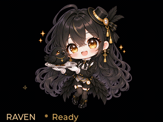

# Raven-Projection

A standalone Raven companion for a 320 x 240 Cubic glass display. The device
runs its own Lua/LVGL application, shows the transparent chibi Raven mascot,
and accepts live status updates over the local network.



The preview is a 4.8-second loop captured from the device renderer.
The app animates locally and keeps running after the computer disconnects.

## Features

- Transparent character artwork on a pure black canvas for glass projection.
- A gentle idle loop with vertical floating, sideways sway, gold sparkles,
  a breathing status indicator, and a short natural blink.
- Six states: `idle`, `thinking`, `working`, `waiting`, `error`, and `offline`.
- Optional progress from 0 to 100. Non-idle states pause the idle animation.
- An HTTP API and a dependency-free Python installation/control client.
- Automatic backups of an existing Raven package and SHA-256 verification
  of every uploaded file.

## Requirements

- A Cubic device with a 320 x 240 display, Lua/LVGL, an SD card, and the
  native system HTTP API. Verified with firmware `1.212`.
- A computer on the same local network, Python 3.10 or later, and `uv`.
- Windows PowerShell only when rebuilding PNG assets. The prepared device
  images are included, so ordinary installation does not require Windows.

## Install

Clone this repository, enter the project directory, and replace the example
IP with your device's IP. Put `--device` before the command:

```shell
uv run --no-project python raven_screen.py --device 192.168.1.100 install
uv run --no-project python raven_screen.py --device 192.168.1.100 get
```

Alternatively, set `RAVEN_DISPLAY_HOST` once for the current shell. For
example, in PowerShell:

```powershell
$env:RAVEN_DISPLAY_HOST = "192.168.1.100"
uv run --no-project python raven_screen.py install
uv run --no-project python raven_screen.py get
```

The app is installed at `/sd/apps/raven_display/`. Select **Raven** in the
device launcher to open it; press HOME to return to the launcher.
Installation does not change the device's startup preference.

A newly installed app must be discovered by the launcher. If the device
already has a DevRun helper containing exactly `app.rescan()`, the client
can run that helper. Otherwise, rescan apps in the launcher and run:

```shell
uv run --no-project python raven_screen.py --device 192.168.1.100 start
```

## Update the state

With `RAVEN_DISPLAY_HOST` set:

```shell
uv run --no-project python raven_screen.py state thinking
uv run --no-project python raven_screen.py state working --progress 42
uv run --no-project python raven_screen.py state waiting
uv run --no-project python raven_screen.py state idle
uv run --no-project python raven_screen.py snapshot --output screen.png
```

Omitting `--progress` clears the previous progress. Entering `idle` resumes
the animation; repeated idle updates preserve the running loop.

The app is ready for a Raven integration, but it does not yet subscribe to
Raven runtime events. The caller supplies the state; connectivity and
timeouts are not inferred automatically. State resets to `idle` on launch.

## HTTP API

Read `/api/system/state` and use its `current_route_base` for the running
app's prefix, normally `/raven_display`.

| Method | Endpoint | Purpose |
| --- | --- | --- |
| GET | `/raven_display/api/state` | Read state, version, display dimensions, and animation telemetry |
| POST | `/raven_display/api/state` | Set `status` and optional integer `progress` |
| POST | `/raven_display/api/snapshot` | Save a device-rendered PNG and return its SD-card path |

Example using the Python client:

```python
from raven_screen import Device

display = Device("192.168.1.100")
display.api(display.route() + "/api/state", "POST", {
    "status": "working",
    "progress": 42,
})
```

Invalid state updates are rejected before changing the current state.
`updated_ms` is device uptime, not a Unix timestamp. Status updates stay
in RAM. The API is available while Raven is the foreground app and uses
the device's existing local HTTP service without adding authentication.

## Artwork and idle animation

The transparent source is `assets/raven-chibi-transparent.png`. The device
uses a 216 x 216 portrait and a 64 x 64 launcher icon. Both preserve alpha;
the display canvas uses pure black around the character.

To rebuild the included assets on Windows:

```powershell
powershell -NoProfile -File .\build-assets.ps1 -ImagePath .\assets\raven-chibi-transparent.png
powershell -NoProfile -File .\build-blink-assets.ps1
uv run --no-project python raven_screen.py --device 192.168.1.100 install
```

See [artwork notes](docs/artwork.md) for the image editing prompt.
The [blink artwork notes](docs/blink-artwork.md) describe the aligned
closed-eye source and the small eyelid overlay extracted from it. Those
regions are specific to the bundled artwork; replacing the character
requires a matching blink source and region coordinates.

The 4.8-second idle loop uses a 50 ms timer and follows a smooth figure-eight
path. It sways 24 pixels to either side and bobs 6 pixels above and below
its resting position: 48 pixels of horizontal travel and 12 vertically.
Gold sparkles drift alongside the movement. The complete character stays
inside the display area above the status bar. Playback reuses the portrait
and makes no per-frame SD-card writes. A small canvas keeps the status
bar visible in snapshots. Exiting releases the animation timer.

Each loop includes a 250 ms blink: closing for 50 ms, holding for 100 ms,
and reopening for 100 ms. Only an eye overlay changes opacity; the original
portrait remains in place. Every non-idle state restores open eyes.
`animation.blink_opacity` reports 0 for open eyes and 255 for closed eyes.

To capture an exact idle pose, use `--phase-ms` from 0 through 4799:

```shell
uv run --no-project python raven_screen.py --device 192.168.1.100 snapshot --phase-ms 1200 --output idle.png
```

To regenerate the GIF preview from exact device-rendered frames:

```shell
uv run --no-project --with imageio-ffmpeg python capture_idle_preview.py --device 192.168.1.100
```

The preview samples the slow motion at 5 fps and includes extra 50 ms
keyframes around the blink, producing 28 frames per loop. The device uses
a nominal 20 timer ticks per second.
Frame capture writes screenshots to the SD card and briefly interrupts
visible playback. Normal animation does not have this capture overhead.

## Project layout

```text
package/                  Device app, metadata, portrait, and launcher icon
assets/                   Full-resolution transparent artwork
docs/                     Idle preview and artwork notes
raven_screen.py           Installation, state updates, and snapshots
build-assets.ps1          Alpha-preserving image resize tool
build-blink-assets.ps1    Aligned eyelid-overlay extraction tool
capture_idle_preview.py    Optional device-frame GIF capture tool
```

Device backups, screenshots, captured frame folders, and generated ZIP
archives are local outputs and are ignored by Git.

## Verification

The device app has been checked on firmware `1.212` for all six states,
progress handling, invalid input rejection, animation pause/resume,
exit/relaunch, and snapshot capture. The GIF preserves the complete
4800 ms loop, including the brief blink.

The installation/control tool uses only Python's standard library.
The optional GIF capture tool additionally uses `imageio-ffmpeg` via `uv`.

## Device references

- [HoloCubic app development](https://github.com/clocteck/holocubic-apps)
- [Lua module APIs](https://github.com/clocteck/holocubic-apps/blob/main/README_LUA.md)
- [LVGL bindings](https://github.com/clocteck/holocubic-apps/blob/main/README_LVGL.md)
